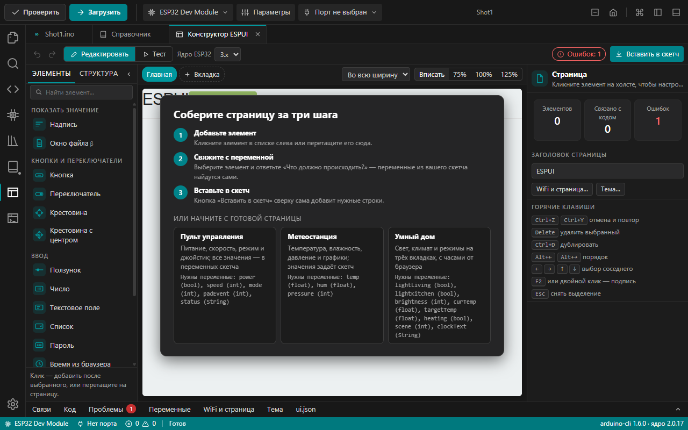
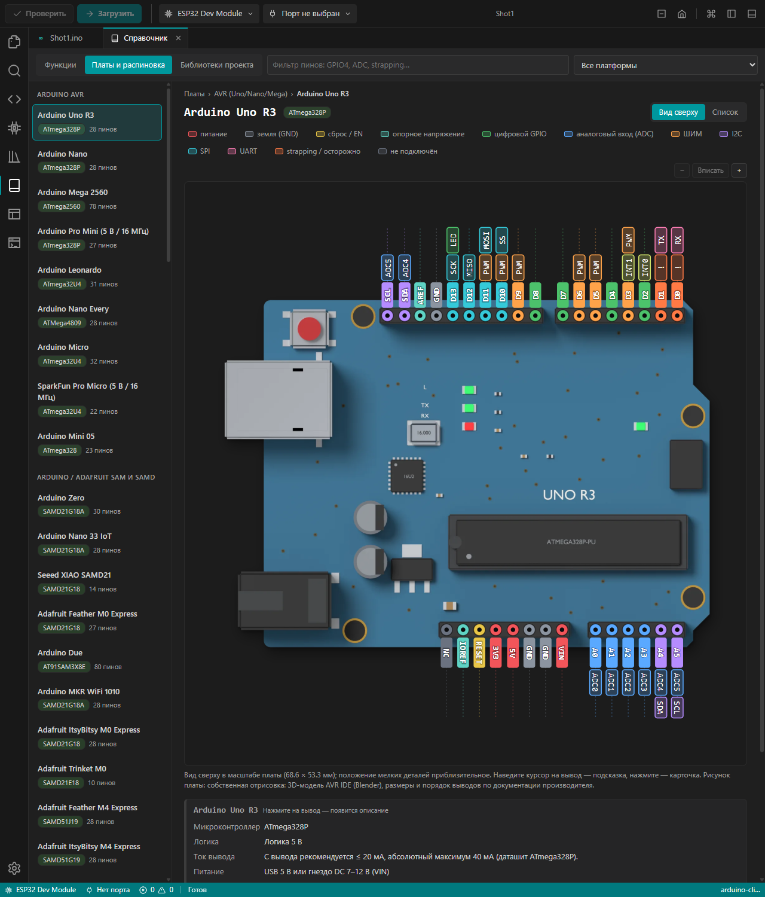

# AVR IDE

Настольная IDE для Arduino, ESP8266/ESP32, STM32 и Raspberry Pi Pico с умным редактором, справочником функций и плат и **визуальными конструкторами веб-интерфейса** для ESP. Работает с `arduino-cli`, ядра плат можно поставить без интернета.

*English: a desktop IDE for Arduino, ESP8266/ESP32, STM32 and RP2040 boards with a smart code editor, a function and board reference, and two visual web-UI builders (ESPUI and HTML+CSS+WebSocket). The interface is in Russian. Windows x64 builds only for now.*


## Возможности

- **Редактор** на Monaco: подсветка, подсказки по функциям и библиотекам проекта, проводник, поиск по проекту, монитор порта и плоттер, панель проблем.
- **Платы и параметры.** Arduino AVR, ESP8266, семейство ESP32 (S2, S3, C3, C6 и др.), STM32 и RP2040. Параметры платы (частота, раздел флеша, USB и т. д.) выбираются в шапке и сохраняются в `sketch.yaml` проекта.
- **Справочник функций и плат.** 86 плат с распиновкой поверх реалистичных 3D-рендеров, функции пинов, предупреждения (strapping-пины, пины флеша и т. п.). Данные плат взяты из официальной документации, у каждой платы указан источник.
- **Конструктор ESPUI.** Страница собирается на холсте, элементы связываются с переменными из скетча, код вставляется в скетч одной кнопкой. Предпросмотр работает на настоящем фронтенде ESPUI.
- **Веб-дизайнер HTML + CSS + WebSocket.** 39 блоков, 21 готовый шаблон, дерево структуры с перетаскиванием, инспектор свойств, адаптивный предпросмотр (ПК, планшет, телефон), генерация кода для ESP. В скетч вставляется той же кнопкой, что и ESPUI, переменные берутся из скетча.
- **Ядра в комплекте.** Ядра AVR и ESP8266 лежат внутри установщика, ядро ESP32 (около 2 ГБ) поставляется отдельным пакетом. Установка без интернета.
- **Библиотеки** из реестра Arduino и с GitHub.
- Тёмная и светлая темы, палитра команд, горячие клавиши.

| Конструктор ESPUI | Веб-дизайнер |
|---|---|
|  |  |



## Как связать веб-интерфейс со скетчем

Оба конструктора (ESPUI и «Веб-сайт») работают одинаково: страница живёт в файле проекта, а IDE следит, чтобы сгенерированный код не расходился со скетчем.

1. Объявите переменные в скетче, как обычно. Конструктор покажет их списком в выборе переменной (в веб-дизайнере — на вкладке «Переменные» и в «Связь» блока). Нужной нет — кнопка «Создать переменную в скетче» покажет, что будет добавлено, и вставит объявление выше подключения страницы.
2. Соберите страницу и нажмите «Вставить в скетч». Откроется окно «Что будет сделано» с построчным diff: записываются `ui_generated.h` + `ui.json` (ESPUI) или `web_generated.h` + `web_design.json` (веб-дизайнер), в скетч добавляются `#include`, вызов запуска в конец `setup()` и вызов обновления в начало `loop()`. Повторная вставка ничего не дублирует.
3. Дальше код страницы обновляется сам. Пока страница подключена, она сохраняется в папку проекта, а перед «Проверить» и «Загрузить» IDE молча перегенерирует `*_generated.h`, если страница или переменные скетча изменились, и показывает «Код страницы обновлён». Отключается в «Настройки → Сборка и загрузка → Обновлять код страницы автоматически». Если в странице есть ошибки (например, переменная пропала из скетча), прежний файл не затирается, а сообщение ведёт кнопкой «Открыть конструктор» к проблеме.
4. Плашка в полосе конструктора показывает состояние: «Не подключено к скетчу» (кнопка «Подключить»), «Подключено, код актуален» или «Подключено, код устарел» (кнопка «Обновить»). Подсказка «Дальше» предложит подключить страницу, если она есть, а в скетче её нет.
5. «Проверить страницу» (кнопка в плашке или команда в палитре) собирает скетч вместе со страницей без загрузки и без обязательной платы; ошибки попадают в «Проблемы» с пояснением.

Пример:

```cpp
float temperature = 21.5;        // ваша переменная: страница её показывает
bool relay = false;              // а эту — ещё и меняет
#include "web_generated.h"       // вставлено IDE, ниже переменных

void setup() {
  Serial.begin(115200);
  wdBegin();                     // вставлено IDE
}

void loop() {
  wdLoop();                      // вставлено IDE
  temperature = readSensor();
  digitalWrite(RELAY_PIN, relay);
}
```

Ограничение: ESPUI и веб-дизайнер поднимают веб-сервер на порту 80, поэтому в одном скетче работает одна страница. IDE предупредит и предложит заменить одну другой.

## Установка

Готовые сборки для Windows 10/11 x64 лежат в [Releases](https://github.com/Serzh2000/avr-ide/releases):

- `AVR IDE-Setup-<версия>.exe` — установщик (около 370 МБ, ядра AVR и ESP8266 внутри);
- `AVR IDE-<версия>-portable.exe` — портативная версия без установки.

Сборки пока **не подписаны**, поэтому Windows SmartScreen может предупредить о неизвестном издателе («Подробнее» → «Выполнить в любом случае»).

## Сборка из исходников

Нужны актуальная LTS-версия Node.js и Windows (разработка идёт на Node.js 24).

```bash
npm install
```

`arduino-cli` в репозиторий не входит (GPL-3.0). Скачайте [arduino-cli 1.6.0 для Windows x64](https://github.com/arduino/arduino-cli/releases/tag/v1.6.0) и положите `arduino-cli.exe` в папку `resources/`.

```bash
npm run dev          # запуск в режиме разработки
npm run typecheck    # проверка типов
npm run build        # сборка приложения в out/
npm run build:cores  # пакеты ядер для офлайн-установки (нужен интернет, см. scripts/README.md)
npm run dist         # установщик и портативная версия в release/
```

Тесты:

```bash
npm run test:e2e     # сквозные сценарии интерфейса, около минуты
node --import ./src/main/libs/tests/register.mjs --test $(git ls-files "*.test.ts")   # юнит-тесты
```

Подробнее: [scripts/README.md](scripts/README.md) (сборка ядер и дистрибутива), [scripts/e2e/README.md](scripts/e2e/README.md) (сквозные тесты), `scripts/boardart/` (генерация рендеров плат в Blender).

## Состояние проекта

Проект в активной разработке, версия 0.1.0.

- Компиляция проверена для шаблонов на ESP32/ESP8266 и для 7 плат STM32/RP2040. **Прошивка на реальных платах, монитор порта и сгенерированный код на устройстве не проверялись.**
- Порядок выводов Morpho-разъёмов у некоторых плат Nucleo взят по аналогии и помечен в заметках платы как неподтверждённый.
- Сборки только для Windows x64. macOS и Linux пока нет.

## Лицензии

Код AVR IDE распространяется по лицензии [MIT](LICENSE).

Установщик включает отдельные компоненты со своими лицензиями, в том числе `arduino-cli` (GPL-3.0, исходный код: https://github.com/arduino/arduino-cli) и ядра плат с инструментами сборки (GPL/LGPL, исходники у проектов-источников). Полный список с источниками и лицензиями: [licenses/THIRD_PARTY.md](licenses/THIRD_PARTY.md). Рендеры плат — собственные 3D-модели проекта.
