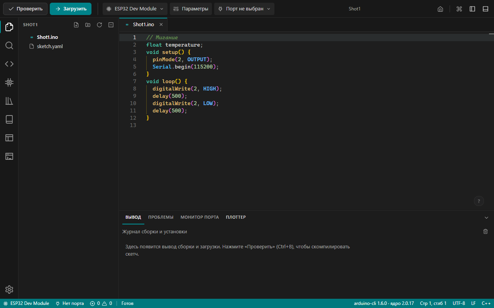
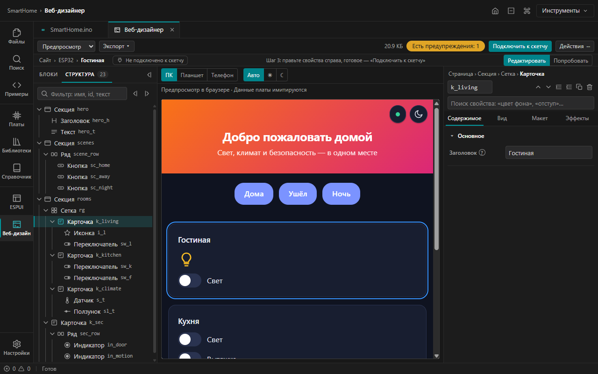

# AVR IDE

Настольная IDE для Arduino, ESP8266/ESP32, STM32 и Raspberry Pi Pico с умным редактором, справочником функций и плат и **визуальными конструкторами веб-интерфейса**. Работает с `arduino-cli`, ядра плат можно поставить без интернета.

*English: a desktop IDE for Arduino, ESP8266/ESP32, STM32 and RP2040 boards with a smart code editor, a function and board reference, and two visual web-UI builders (ESPUI and HTML+CSS+WebSocket). The HTML designer can link to Arduino sketches on ESP and Wi-Fi Pico boards. The interface is in Russian. Windows x64 builds only for now.*



## Возможности

- **Редактор** на Monaco: подсветка, подсказки по функциям и библиотекам проекта, проводник, поиск по проекту, монитор порта и плоттер, панель проблем.
- **CircuitPython для Raspberry Pi Pico.** Отдельный редактор Python для Pico, Pico W, Pico 2 и Pico 2 W. Открывается через «Создать проект → CircuitPython для Pico» или палитру команд. Можно открыть и сохранить файл `.py`, попробовать пример мигания и записать текущий код как `code.py` на диск `CIRCUITPY`. В редакторе есть ссылки на официальные прошивки UF2 для каждой модели. Библиотеки программы добавляются вручную в папку `lib` на плате.
- **Платы и параметры.** Arduino AVR, ESP8266, семейство ESP32 (S2, S3, C3, C6 и др.), STM32 и RP2040. Параметры платы (частота, раздел флеша, USB и т. д.) выбираются в шапке и сохраняются в `sketch.yaml` проекта.
- **Справочник функций и плат.** 86 плат с распиновкой поверх реалистичных 3D-рендеров, функции пинов, предупреждения (strapping-пины, пины флеша и т. п.). Данные плат взяты из официальной документации, у каждой платы указан источник.
- **Конструктор ESPUI.** Страница собирается на холсте, элементы связываются с переменными из скетча, код вставляется в скетч одной кнопкой. Предпросмотр работает на настоящем фронтенде ESPUI.
- **Веб-дизайнер HTML + CSS.** Визуальные блоки и собственный HTML/CSS, адаптивный предпросмотр (ПК, планшет, телефон), экспорт HTML для браузера или HTTP-сервера. Для ESP32, ESP8266, Pico W и Pico 2 W можно подключить страницу к Arduino-скетчу и связать её с переменными и выводами по WebSocket. Варианты экспорта и требования к платам — в [таблице ниже](#как-связать-веб-интерфейс-со-скетчем).
- **Ядра в комплекте.** Ядра AVR и ESP8266 лежат внутри установщика, ядро ESP32 (около 2 ГБ) поставляется отдельным пакетом. Установка без интернета.
- **Восстановление библиотек скетча.** IDE устанавливает однозначно определённые зависимости из реестра Arduino при открытии проекта. Для неоднозначных зависимостей есть выбор в один клик; ручная установка с GitHub по-прежнему доступна.
- **Проекты STM32 C/C++.** Создаются через «Создать проект → STM32 C/C++». Открытие папки с `avride.project.json` выбирает рабочую область STM32. Проект без Arduino API по образцу Keil и STM32CubeIDE: файл `avride.project.json`, CMSIS, startup, скрипт компоновщика, конфигурации Debug и Release, программатор ST-Link. Готовы мастер проекта, панель проекта и **сборка** (`arm-none-eabi-gcc`: компилятор ставится одной кнопкой с проверкой SHA-256, файлы CMSIS скачиваются из репозиториев ST по подтверждению и проверяются по git-SHA-1, вкладка «Размер» с полосками Flash и RAM, конфигурации Debug и Release, экспорт Makefile и CMakeLists.txt). Прошивка и отладка через ST-Link, J-Link и CMSIS-DAP (OpenOCD и GDB, SWD): мастер «Прошивка» и вкладка «Отладка», точки останова, шаги, регистры, периферия по SVD; вкладка «SWO» принимает `printf` через ITM (шаблон проекта «printf через SWO»). **Конфигуратор «Пины и тактирование»** (аналог STM32CubeMX, но легче): схема корпуса по базе чипов, выводы и периферия, проверка конфликтов, блок-схема тактирования с проверкой пределов, генерация `gpio`, `clock`, `uart`, `board` на регистрах CMSIS или HAL с блоками `USER CODE` (F1, F4, G4; остальное честно «вручную»). **Умный редактор C/C++** (индекс символов проекта и заголовков CMSIS без внешних зависимостей): подсказки после `GPIOA->` и `RCC->` по полям структур регистров, макросы битов (`RCC_APB2ENR_IOPCEN`, `GPIO_ODR_ODR13`), hover с адресом и смещением регистра, значение макроса, F12 и Ctrl+клик по определению (в том числе в заголовок CMSIS), Shift+F12 ссылки, Ctrl+T поиск символа, F2 переименование с предпросмотром, форматирование через `clang-format` (если установлен), подсветка ассемблера, скриптов компоновки и карты, проверка `avride.project.json`. Пока проверено на имитаторах, первая проверка на плате — по [docs/pro-hardware-test.md](docs/pro-hardware-test.md). Подробности: [docs/pro-mode.md](docs/pro-mode.md).
- Тёмная и светлая темы, палитра команд, горячие клавиши.

## Интерфейс

### Конструктор ESPUI


### Веб-дизайнер



### Справочник плат


[Посмотреть скриншот справочника функций](docs/img/reference.png)

## Как связать веб-интерфейс со скетчем

| Плата и среда | Связь страницы со скетчем | Статическая страница на плате |
|---|---|---|
| ESP32 / ESP8266, Arduino | ESPUI и веб-дизайнер | Подключение к скетчу без привязок |
| Pico W / Pico 2 W, ядро Earle Philhower (Arduino-Pico) | Веб-дизайнер: переменные и выводы по WebSocket. Нужны **ESP Async WebServer** и **RPAsyncTCP** из менеджера библиотек. | Через «Размещение…» |
| Pico W / Pico 2 W, CircuitPython | Нет | Экспорт `code.py` и `page_bundle.html` |
| Uno R3 + ESP-12F с ESP-AT | Нет | Экспорт скетча для WiFiEspAT |
| Pico без W, Uno R4 WiFi, Nano RP2040 Connect, STM32 и остальные платы | Нет | Только экспорт HTML для браузера или собственного сервера; прошивка для этих плат не генерируется |

На Pico W / Pico 2 W выберите плату именно из ядра Arduino-Pico и откройте «Веб-дизайн → Подключить к скетчу». Настройте домашнюю сеть или точку доступа в разделе «Страница и WiFi». После загрузки скетча откройте адрес `[web] http://…` из монитора порта. Это локальный сервер: не выставляйте его в интернет. Сборка проверена для обеих моделей, обмен по сети на физических платах ещё не проверялся. Форма OTA не включает серверный обработчик загрузки прошивки.

При подключении страница живёт в файле проекта, а IDE следит, чтобы сгенерированный код не расходился со скетчем.

1. Объявите переменные в скетче, как обычно. Конструктор покажет их списком в выборе переменной (в веб-дизайнере — на вкладке «Переменные» и в «Связь» блока). Нужной нет — кнопка «Создать переменную в скетче» покажет, что будет добавлено, и вставит объявление выше подключения страницы.
2. Соберите страницу и нажмите «Подключить к скетчу» в верхней строке конструктора. Откроется окно «Что будет сделано» с построчным diff: записываются `ui_generated.h` + `ui.json` (ESPUI) или `web_generated.h` + `web_design.json` (веб-дизайнер), в скетч добавляются `#include`, вызов запуска в конец `setup()` и вызов обновления в начало `loop()`. Повторная вставка ничего не дублирует.
3. Дальше код страницы обновляется сам. Пока страница подключена, она сохраняется в папку проекта, а перед «Проверить» и «Загрузить» IDE молча перегенерирует `*_generated.h`, если страница или переменные скетча изменились, и показывает «Код страницы обновлён». Отключается в «Настройки → Сборка и загрузка → Обновлять код страницы автоматически». Если в странице есть ошибки (например, переменная пропала из скетча), прежний файл не затирается, а сообщение ведёт кнопкой «Открыть конструктор» к проблеме.
4. Плашка в полосе конструктора показывает состояние: «Не подключено к скетчу», «Подключено, код актуален» или «Подключено, код устарел» (кнопка «Обновить»). Подсказка «Дальше» предложит подключить страницу, если она есть, а в скетче её нет.
5. «Проверить страницу» (кнопка в плашке или команда в палитре) собирает скетч вместе со страницей без загрузки и без обязательной платы; ошибки попадают в «Проблемы» с пояснением.

Пример:

```cpp
float temperature = 21.5;        // ваша переменная: страница её показывает
bool relay = false;              // а эту — ещё и меняет
#include "web_generated.h"       // вставлено IDE, ниже переменных

void setup() {
  Serial.begin(115200);
  wdBegin();                     // вставлено IDE
}

void loop() {
  wdLoop();                      // вставлено IDE
  temperature = readSensor();
  digitalWrite(RELAY_PIN, relay);
}
```

Ограничение: ESPUI и веб-дизайнер поднимают веб-сервер на порту 80, поэтому в одном скетче работает одна страница. IDE предупредит и предложит заменить одну другой.

## Как восстановить библиотеки скетча

Откройте Arduino-скетч. IDE проверяет сохранённые `.ino`, C/C++-файлы и заголовки проекта, пропускает локальные и уже доступные заголовки. Если для отсутствующего безусловного `#include` найден один совместимый поставщик, IDE запускает установку из реестра Arduino. Объявленные зависимости устанавливает `arduino-cli`. Установленные версии IDE не заменяет автоматически.

Если поставщиков несколько, откройте **Библиотеки → Зависимости скетча** и нажмите нужную библиотеку. Для точного выбора можно положить рядом с `.ino` файл `avr-ide-libraries.json`:

```json
{ "libraries": ["DHT sensor library@1.4.6"] }
```

Механизм не выбирает библиотеки по похожему имени и не устанавливает автоматически пакеты с GitHub, ZIP-архивы или зависимости из условных веток препроцессора. Их можно явно указать в манифесте, если они есть в реестре, или установить вручную. Для `default_profile` в `sketch.yaml` действует штатный механизм Arduino CLI: зависимости скачиваются в изолированный кэш при сборке, а не в общий каталог при открытии.

Автоустановку можно отключить в **Настройки → Сборка и загрузка → Восстанавливать библиотеки автоматически**. В панели зависимостей останется кнопка «Установить найденные».

## Установка

Готовые сборки для Windows 10/11 x64 лежат в [Releases](https://github.com/Serzh2000/avr-ide/releases):

- `AVR IDE-Setup-<версия>.exe` — установщик (около 370 МБ, ядра AVR и ESP8266 внутри);
- `AVR IDE-<версия>-portable.exe` — портативная версия без установки.

Сборки пока **не подписаны**, поэтому Windows SmartScreen может предупредить о неизвестном издателе («Подробнее» → «Выполнить в любом случае»).

## Сборка из исходников

Нужны актуальная LTS-версия Node.js и Windows (разработка идёт на Node.js 24).

```bash
npm install
```

`arduino-cli` в репозиторий не входит (GPL-3.0). Скачайте [arduino-cli 1.6.0 для Windows x64](https://github.com/arduino/arduino-cli/releases/tag/v1.6.0) и положите `arduino-cli.exe` в папку `resources/`.

```bash
npm run dev          # запуск в режиме разработки
npm run typecheck    # проверка типов
npm run build        # сборка приложения в out/
npm run build:cores  # пакеты ядер для офлайн-установки (нужен интернет, см. scripts/README.md)
npm run dist         # установщик и портативная версия в release/
```

Тесты:

```bash
npm run test:e2e     # сквозные сценарии интерфейса, около минуты
node --import ./src/main/libs/tests/register.mjs --test $(git ls-files "*.test.ts")   # юнит-тесты
```

Подробнее: [scripts/README.md](scripts/README.md) (сборка ядер и дистрибутива), [scripts/e2e/README.md](scripts/e2e/README.md) (сквозные тесты), `scripts/boardart/` (генерация рендеров плат в Blender).

## Состояние проекта

Проект в активной разработке.

- Компиляция проверена для шаблонов на ESP32/ESP8266 и для 7 плат STM32/RP2040. **Прошивка на реальных платах, монитор порта и сгенерированный код на устройстве не проверялись.**
- Порядок выводов Morpho-разъёмов у некоторых плат Nucleo взят по аналогии и помечен в заметках платы как неподтверждённый.
- Сборки только для Windows x64. macOS и Linux пока нет.

## Лицензии

Код AVR IDE распространяется по лицензии [MIT](LICENSE).

Установщик включает отдельные компоненты со своими лицензиями, в том числе `arduino-cli` (GPL-3.0, исходный код: https://github.com/arduino/arduino-cli) и ядра плат с инструментами сборки (GPL/LGPL, исходники у проектов-источников). Полный список с источниками и лицензиями: [licenses/THIRD_PARTY.md](licenses/THIRD_PARTY.md). Рендеры плат — собственные 3D-модели проекта.
